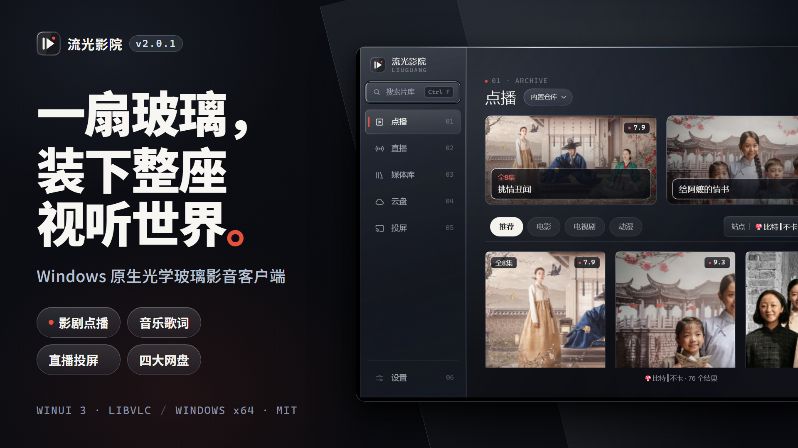

# 流光影院 · Liuguang Cinema

基于 **C#、WinUI 3（Windows App SDK 1.8）、.NET 10 与 LibVLC** 的 Windows x64 原生桌面影音客户端，集成点播、直播、跨站搜索、四大个人网盘、本地媒体库、弹幕、AI 字幕、离线下载与投屏接收。



> **项目定位与边界**：本项目是原生 Windows 桌面应用，不是 Android TVBox 模拟器，也不是 FongMi/TV 官方分支。界面、播放控制与多数站点适配器由 C# 原生实现，部分 CatVod 站点通过随包分发的独立 Java 17 进程运行。应用本身不托管或提供任何影视资源，所有片源、直播、网盘、字幕与弹幕均来自用户配置或第三方公开服务。
>
> 图文功能导览见 [项目功能介绍](docs/showcase.md)。

---

## 主要功能

| 模块 | 实现说明 |
| --- | --- |
| **界面与主题** | 深色（暗室素墨）、浅色（暖白低眩光）与高对比度主题；使用 WinUI 3 `AcrylicBrush` 与自研多层光学玻璃控件 `GlassSurface`；全站横向/竖向导航样式收敛至 `Styles/Navigation.xaml` 与 `Controls/NavigationMotion.cs`，由 WinUI Composition 驱动可打断弹簧过渡 |
| **点播与直播** | 兼容常见 TVBox 单仓、多仓、Type 0/1/4 与 M3U/TXT 直播源；内置 **22 个原生 C# 站点适配器**并配合 Java CatVod 兼容层；支持分类筛选、选集、多线路、EPG 节目单、收藏与断点续播 |
| **搜索与换源** | 支持多站并发搜索、本地历史/片库即时联想 + 防抖流式远端建议（不抢占中文 IME 焦点）、单站重试、应用内验证码/安全验证弹窗与同名片源切换 |
| **播放器** | 基于 LibVLC，默认优先硬件解码（`:avcodec-hw=any`，不支持时自动回退软解）；支持倍速、画质、画面比例、多音轨/外挂字幕、片头片尾跳过、全屏、画中画与默认开启的播放期防息屏/防休眠；播放中无操作 3 秒且指针离开控件后自动隐藏控制层与鼠标 |
| **弹幕与字幕** | 支持弹弹play 开放弹幕库（本地 16 MB 哈希匹配、在线片名规范化匹配与手动搜集）及 B 站弹幕，使用单调步进时钟减少回跳；支持字幕时间偏移（±60s）与 `0.80x–1.25x` 调速 |
| **AI 字幕（需自备 Key）** | 接入阿里云百炼 API（用户在设置中自行填入 API Key）：支持提取音轨生成字幕（`paraformer-v2` / `qwen3-asr-flash-filetrans`）、双语翻译（`qwen-mt-flash` / `qwen-mt-plus`）与 WASAPI 进程环回实时字幕（`qwen3-asr-flash-realtime`） |
| **个人网盘** | 支持阿里云盘（含资源库/备份盘与设备会话签名）、夸克、UC、百度网盘登录与目录浏览；通过本地 `127.0.0.1` 代理和分块预读直接播放 |
| **本地媒体与下载** | 支持本地目录递归扫描与变更监听、同名侧车字幕/弹幕自动挂载、Windows「打开方式」直达播放（跳过站点与爬虫初始化）；支持单集另存与批量/HLS 下载 |
| **投屏接收与清理** | 支持局域网 DLNA/UPnP 发现与手机扫码选片，电脑端确认后播放；提供按分类扫描与显式勾选确认的缓存/临时文件清理 |
| **安装与更新** | 提供 Inno Setup 安装包与免安装便携 ZIP；内置 GitHub Release 检查、国内镜像测速回退、分段下载、文件级差异增量更新与 SHA-256 校验 |

> **内置站点说明**：内置公开配置中大多数站点已通过原生 C# 或 Java CatVod 适配，但少数依赖外部闭源混淆 DEX 或加密私有参数的站点（如 `粤迷`、`花生`、`风云` 以及带加密参数的 `光影`、`奶酪`）没有公开可实现的接口，应用会如实标注为 `（无公开实现）`；此外部分站点受上游反爬、验证码或域名变动影响，可用性取决于第三方服务状态，详见 [站点适配与验收](docs/site-verification.md)。

---

## 下载与安装

### 系统要求

- **64 位 Windows 10 1809（Build 17763）及以上**（推荐 Windows 11；Mica 背景、标题栏定制与 HDR 输出在不支持的系统、多显示器或远程桌面环境下自动降级）
- 支持 D3D11 的显卡驱动（不支持硬件解码时自动回退软件解码）
- 无需管理员权限，无需预装 .NET、Java 或 VC++ 运行库（发行包已内置自包含运行时、裁剪版 OpenJDK 与应用本地 VC++ CRT DLL）

从 [GitHub Releases](https://github.com/binchen6/Liuguang-Cinema/releases) 下载：
- `TV-Setup-<version>-x64.exe` — 标准安装器（推荐）
- `TV-<version>-win-x64-portable.zip` — 解压即用便携包

> 社区开源发行版未附带商业 Authenticode 代码签名证书，在开启 Windows 11 **智能应用控制（Smart App Control）** 或 SmartScreen 的设备上可能出现提示或拦截，详见 [智能应用控制与签名说明](docs/smart-app-control.md)。下载后建议核对官方 SHA-256：

```powershell
Get-FileHash .\TV-Setup-1.9.4-x64.exe -Algorithm SHA256
Get-Content .\TV-Setup-1.9.4-x64.exe.sha256
```

---

## 常用操作与快捷键

- **片源管理**：首次启动加载内置配置并缓存至本地；可在 **设置 → 片源** 导入兼容单仓、多仓或直播源。
- **播放控制**：无操作 3 秒且鼠标不在控件上停留时自动收起顶/底栏并隐藏鼠标（悬停控件、拖拽进度条或弹层打开期间保持显示）；播放期防息屏/防休眠默认开启，可在 **设置 → 播放** 或播放器「更多选项」中关闭。

| 快捷键 | 功能 | 快捷键 | 功能 |
| --- | --- | --- | --- |
| `Space` | 播放 / 暂停 | `M` / `F` | 静音 / 全屏 |
| `←` / `→` | 后退 / 前进 5 秒 | `P` / `D` | 选集 / 弹幕开关 |
| `↑` / `↓` | 音量调节 | `Z` / `X` | 字幕前移 / 后移 0.5 秒 |
| `A` / `I` | 切换画面比例 / 媒体信息 | `Esc` | 关闭浮层或返回 |

---

## 隐私与本地数据

默认数据保存在 `%LOCALAPPDATA%\TV`（包含 `tv.db`、配置缓存 `config/last-good.json`、`cache` 及轮转日志 `diagnostic.log` / `last-error.log`）：

- **无自建统计上报**：应用不向作者收集或上传观影记录与账号信息；访问第三方片源、网盘、豆瓣、B 站、弹弹play 或阿里云百炼时遵循各自服务条款。
- **凭据加密与头隔离**：网盘 Cookie/Token、弹弹play 凭证与百炼 API Key 均通过当前 Windows 用户 **DPAPI** 加密存储；本地媒体代理仅监听 `127.0.0.1` 并在跨域重定向时剥离敏感请求头；诊断日志自动脱敏常见密钥字段。
- **不修改系统网络设置**：应用内自定义 DNS 仅用于本进程 HTTP 请求。

---

## 从源码构建

环境要求：**.NET 10 SDK**、**Windows 10/11 SDK 19041+**、**JDK 17+ 与 Maven**（仅修改 Java 引擎时需要）、**Inno Setup 6**（仅打包安装器时需要）。

```powershell
git clone https://github.com/binchen6/Liuguang-Cinema.git
cd Liuguang-Cinema

# 还原并编译 x64 Release 主程序
# 输出路径：src/TV/bin/x64/Release/net10.0-windows10.0.19041.0/win-x64/TV.exe
dotnet restore src/TV/TV.csproj --locked-mode
dotnet build src/TV/TV.csproj -c Release -p:Platform=x64 -p:RuntimeIdentifier=win-x64 --no-restore

# 可选：修改 engine/catvod 后重新打包 Java 引擎
mvn -DskipTests -f engine/catvod/pom.xml package

# 使用隔离目录运行，避免影响正式用户数据
$env:TV_DATA_ROOT = Join-Path $PWD 'artifacts/tmp/dev-profile'
& .\src\TV\bin\x64\Release\net10.0-windows10.0.19041.0\win-x64\TV.exe

# 打包安装器、便携包与增量补丁（输出至 artifacts/installers/）
pwsh -NoProfile -File ./scripts/build-installer.ps1
```

---

## 目录结构与文档

```text
src/TV/                  C# / WinUI 3 主程序
  Styles/ & Controls/    设计令牌、矢量图标、GlassSurface、弹幕与导航控制器
  Views/ & ViewModels/   页面 XAML、状态绑定与 MotionService 动效编排
  Models/                媒体、站点、网盘与持久化模型
  Services/
    AI/                  阿里云百炼字幕生成、翻译、音轨提取与实时字幕
    Vod/ & Spider/       CMS、22 个原生 C# 站点适配器、换源恢复与 Java IPC
    Playback/            播放解析、HLS/DASH、LibVLC、弹幕、字幕、防休眠与下载
    Cloud/               四网盘、设备会话签名、分块缓存与回环代理
    Live/ & Casting/     直播源、EPG 与 DLNA/扫码投屏接收
    Library/ & Metadata/ 本地媒体索引、目录监视与豆瓣元数据
    Http/ & Imaging/     自定义 DNS、跨域头过滤与 HTTP/2 图片缓存
    Persistence/         SQLite、DPAPI 密钥库与安全清理（Maintenance/）
    Updates/             GitHub 更新检查、镜像下载与 SHA-256 校验
engine/catvod/           Java 17 CatVod JSON IPC 引擎
third_party/             上游依赖快照与许可
installer/ & scripts/    Inno Setup 脚本、构建与验收脚本
docs/                    设计规范、开发指南、站点验收与发行说明
```

文档索引见 [文档中心](docs/README.md)：[功能介绍](docs/showcase.md) · [开发指南](docs/development.md) · [设计语言](docs/brand-design-system.md) · [设计契约](docs/design-guide.md) · [动效规范](docs/motion-spec.md) · [智能应用控制说明](docs/smart-app-control.md) · [站点验收](docs/site-verification.md) · [1.9.4 发行说明](docs/releases/release-1.9.4.md)。

---

## 许可与致谢

- 原创代码遵循 [MIT License](LICENSE)；第三方组件与上游服务适用各自许可，详见 [THIRD_PARTY.md](THIRD_PARTY.md)。
- 致谢：FongMi/TV 与 CatVodSpider 社区、bizhangjie、AndroidCatVodSpider、VideoLAN / LibVLCSharp、.NET 与 Windows App SDK、QRCoder、SkiaSharp、AngleSharp 及相关开源维护者。
