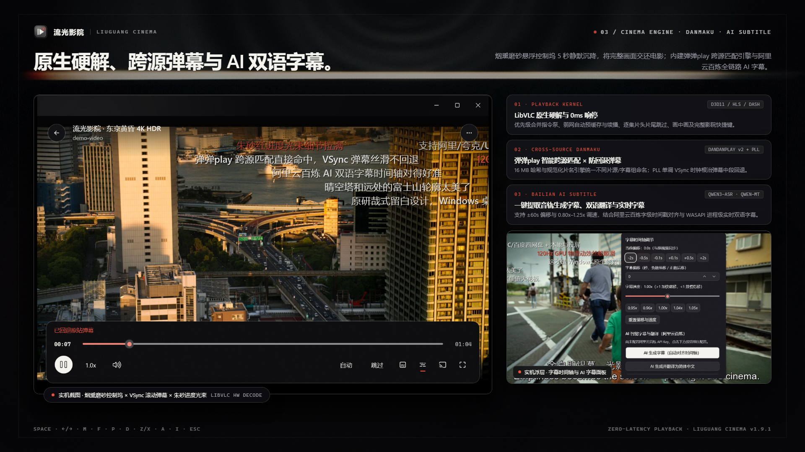

# 流光影院：把 Windows 桌面变成一座安静的私人放映厅

在 Windows 上看片，很多人的桌面常年堆着三四个工具：浏览器找源、网盘客户端缓存、本地播放器解码，再临时去翻字幕站。如果想在电脑上用 TVBox 生态，常见方案往往要么是套壳模拟器，要么界面杂乱、弹窗四起。

**流光影院（Liuguang Cinema）** 想把这件事做回纯粹。它不是 Android 端模拟器，而是用 **C#、WinUI 3 与 LibVLC** 从零写出的 Windows 原生桌面影院，通过独立的 Java 17 进程兼容复杂 CatVod 站点，把点播、直播、四大网盘、本地片库、跨源弹幕、AI 字幕翻译和无线投屏收进一个安静的窗口里。

---

## 一、白 · 隙 · 镜：让界面退到影像身后

多数影音软件喜欢堆砌高饱和按钮和厚重卡片，但看电影时，人眼真正想看的只有海报、片名和画面。

从 1.9.0 开始，流光影院确立了「**白 · 隙 · 镜（SHIRO · MA · GLASS）**」设计语言——借鉴原研哉的留白美学与瑞士平面排版，把界面做轻、做退：

- **暗室素墨与温润护眼素白双主题**：默认 `#0B0B0D` 素墨底适合沉浸观影，`#ECE9E1` 温润亚麻宣纸白底配月白晶玉五层光学玻璃适合长时间日间护眼翻阅；另配完整的 Windows 高对比度无障碍映射。
- **建筑级磨砂与克制色彩**：只在侧栏导轨、吸顶筛选坞、悬浮控制层等空间层级使用 WinUI 3 `AcrylicBrush` 与 `1px` 高光描边，主次按钮依靠墨白反差区分，只用一抹朱砂红（`#E8503E` / `#CE3A2B`）点亮品牌光点、滑轨、直播呼吸灯与进度光束。
- **120Hz GPU 可打断物理动效**：所有页面转场、海报双层景深、导航滑轨与点播页 1:1 跟手吸顶收起都在 Compositor 线程用弹簧物理驱动，快速连点或中途折返都能自然衔接动量，不跳帧、不卡 UI。

---

## 二、原生硬解、跨源弹幕与 AI 双语字幕

坐下来真正开始看片时，播放体验直接决定一款影院软件的上限。

流光影院的播放层基于 **LibVLC 硬件解码**（显卡不支持时自动回退软解），做了优先级合并指令队列，空格与点击播放/暂停零延迟响应；顶部双分体浮岛与五层光学磨砂底部控制坞在无操作 3 秒且鼠标指针离开控件后一起沉降并隐藏鼠标，播放期间默认防止电脑息屏与休眠，把完整银幕交还电影。弱网时会自动预缓存并在可控次数内重试，也不会擅自把你手动选定的原画降档。

围绕「看懂」和「看得热闹」，播放器补齐了两块核心拼图：

- **弹弹play 开放弹幕 + 防回退时钟**：本地片源按前 16 MB 哈希精准匹配，在线片源通过跨源规范化引擎（`MediaMatching`）自动剥离字幕组、分辨率与编码噪音，让不同站点的同一集命中同一条弹幕流，同时拒绝把真人剧错配到无关动画。渲染层采用 PLL 单调 VSync 时钟，彻底消除弹幕滚到一半回退重滚的问题。
- **阿里云百炼全链路 AI 字幕**：点击底栏「字幕」，除了 ±60 秒偏移与 `0.80x–1.25x` 调速，还能直接提取当前视频音轨自动生成带字级时间轴的字幕（`paraformer-v2` / `qwen3-asr-flash-filetrans`）、调用 `qwen-mt` 一键双语翻译，或通过 WASAPI 进程级环回开启实时字幕（`qwen3-asr-flash-realtime`）。

---

## 三、全场景聚合：片源、直播、四网盘与跨屏投送

除了点播画廊，流光影院把日常看片的几种高频入口统一进了同一套操作逻辑：

- **点播与跨站换源**：兼容 TVBox 单仓/多仓配置，内置 20+ 原生 C# 站点高速适配并辅以 Java CatVod 兼容层；跨站并发搜索配 0ms 即时 + 80ms 流式并发非抢焦中文 IME 搜索预测浮层，详情页支持一键同名换源与批量/HLS 离线下载。
- **广播级直播与 EPG**：导入 M3U/TXT 直播源后按分组聚合，带 `ON AIR` 状态灯、实时 EPG 节目单与多线路秒切。
- **四大个人网盘直读**：集中管理阿里云盘（支持资源库/备份盘双目录与纯 C# 设备签名）、夸克、UC 与百度网盘；通过本机 `127.0.0.1` 安全代理与 Range 分块预读直接播放，不用反复转存。
- **投屏接收与本地片库**：支持 DLNA/UPnP 与手机扫码浏览器选片，电脑确认后直接播放；本地支持文件夹递归监视、同名侧车字幕/弹幕自动挂载，以及右键「打开方式」跳过站点初始化极速起播。

---

## 四、为 Windows 精工打磨：干净、私密、开箱即用

作为一款开源桌面软件，工程细节往往藏在看不见的地方：

- **纯净开箱**：无需管理员权限，也不要求系统预装 .NET、Java 或 VC++ 运行库；发布包内置微软签名本地 CRT 与裁剪版 OpenJDK，已签名二进制占比达 **98.4%（726 / 738）**。安装包取消固实解压与嵌套 `.exe`，实测约 **300 ms** 即可弹出界面，同时提供解压即用的便携版 ZIP。
- **轻量增量更新**：内置 GitHub 正式版自动检查与限流兜底，下载时并行测速优选国内 HTTPS 加速节点并进行多路 Range 分片断点续传；日常升级仅需几 MB 的双向差异增量包（如 `1.9.0 → 1.9.1` 仅 **9.6 MB**），所有字节强制核对官方 SHA-256，校验异常自动回切 GitHub 直连。
- **零遥测与本机加密**：软件不收集用户观影记录；网盘凭据、弹弹play 凭证与阿里云百炼 API Key 全部通过当前 Windows 用户的 **DPAPI** 加密落库，回环代理严格阻断跨域敏感请求头，诊断日志自动脱敏。

---

## 获取与参与

- **下载安装包 / 便携包**：前往 [GitHub Releases](https://github.com/binchen6/Liuguang-Cinema/releases) 获取 `TV-Setup-<version>-x64.exe` 或 `TV-<version>-win-x64-portable.zip`（建议核对同页 `.sha256`）。
- **源码与完整文档**：项目原创代码采用 MIT 协议开源，构建与架构说明见根目录 [README](../README.md) 与 [文档中心](README.md)。

> 应用本身不托管任何影视资源，站点配置、直播列表、网盘文件、字幕与弹幕均来自用户配置或第三方服务，请遵守相应服务条款。
