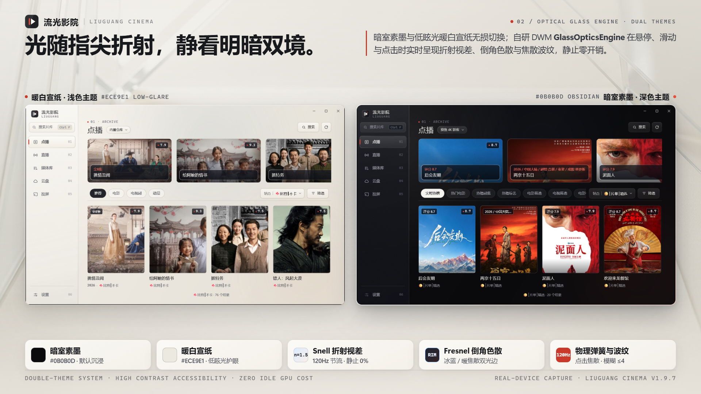
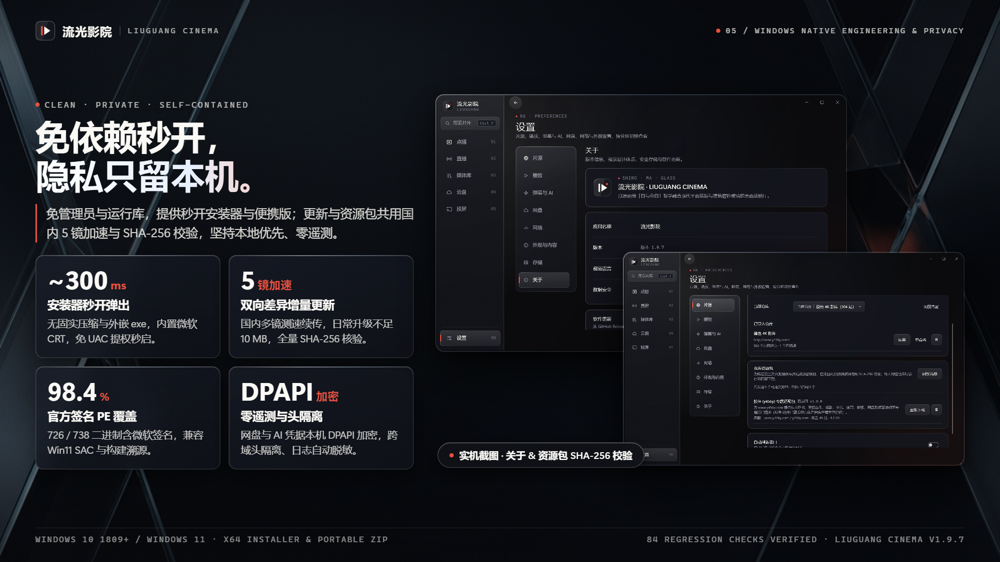

# 流光影院功能介绍

**流光影院（Liuguang Cinema）** 是一款基于 **C#、WinUI 3 与 LibVLC** 开发的 Windows x64 原生桌面影音客户端，辅以独立裁剪的 Java 17 进程兼容部分 CatVod 站点。在一个桌面窗口内整合点播、直播、跨站搜索、四大个人网盘、本地片库、弹幕、AI 字幕与投屏接收。

---

## 一、界面设计与双主题

界面采用克制的留白与细线排版，减少卡片嵌套与色彩干扰：

- **深色、浅色与高对比度主题**：深色主题采用 `#0B0B0D` 低反光暗底；浅色主题采用 `#ECE9E1` 暖灰白画布与柔墨文字，降低长时间浏览的眩光；同时提供完整的 Windows 高对比度语义映射。
- **分层玻璃与可控模糊开销**：仅在主侧栏、吸顶筛选栏、搜索命令条、检视面板等少量宏观区域使用 WinUI 3 `AcrylicBrush`（每屏 ≤ 4 块），列表角标与高频卡片使用零背景模糊的半透明表面；主次操作通过高反差明暗区分，朱砂红（`#E8503E` / `#C93A2B`）仅用于焦点指示条、进度条与直播状态点。
- **可打断 Composition 动效**：页面切换、导航滑轨、海报悬停与点播页吸顶收起均由 WinUI Composition 驱动，连点或反向操作时可中途打断衔接，关闭系统/应用动效后立即静态落位。

---

## 二、原生解码、弹幕与 AI 字幕

播放层基于 **LibVLC**，默认开启硬件解码（`:avcodec-hw=any`，自动优先 D3D11VA 并在不支持时回退 DXVA2 或软解），使用高优先级合并控制队列缩短播放/暂停与拖动响应。

- **沉浸观看体验**：播放中无操作 3 秒且鼠标不在控件上停留时，顶/底栏自动收起并同步隐藏鼠标指针（移动鼠标或悬停控件后即刻恢复）；播放期间默认通过 Windows 电源请求阻止息屏与休眠（可在设置或播放器菜单中关闭）。
- **弹弹play 与 B 站弹幕**：本地文件通过前 16 MB 哈希匹配，在线剧集经规范化片名/集数匹配引擎（`MediaMatching`）减少不同站源命名差异导致的错配，并支持手动搜集；渲染层采用单调步进时钟，避免因播放时间回抖造成弹幕倒退。
- **阿里云百炼 AI 字幕（需自备 API Key）**：支持 ±60 秒偏移与 `0.80x–1.25x` 调速；在设置中填入个人百炼 Key 后，可提取音轨生成时间轴字幕（`paraformer-v2` / `qwen3-asr-flash-filetrans`）、调用 `qwen-mt` 翻译，或通过 WASAPI 进程环回开启实时字幕（`qwen3-asr-flash-realtime`）。

---

## 三、点播、直播、网盘与投屏

- **点播与跨站搜索**：兼容常见 TVBox 单仓/多仓配置，内置 22 个原生 C# 站点适配器与 Java CatVod 兼容层；支持非抢焦中文 IME 联想浮层、多站并发搜索、应用内验证码/安全验证弹窗、同名片源切换与离线下载。（注：内置配置中 5 个依赖外部闭源混淆 DEX 或加密私有参数的站点无公开实现，界面中如实标注。）
- **直播与 EPG**：支持 M3U/TXT 直播源导入、分组浏览、EPG 节目单与多线路切换。
- **四大个人网盘**：支持阿里云盘（含资源库/备份盘与设备签名）、夸克、UC 与百度网盘登录与目录直读，通过 `127.0.0.1` 回环代理与分块缓存播放，无需手动转存。
- **本地片库与投屏**：支持本地目录递归监听、同名侧车字幕/弹幕挂载、右键「打开方式」直达播放（跳过站点初始化）；支持局域网 DLNA/UPnP 发现与手机扫码选片，电脑端确认后播放。

---

## 四、安装、更新与隐私边界

- **独立运行与低门槛安装**：无需管理员权限，无需预装 .NET、Java 或 VC++ 运行库；发布包内置裁剪版微软签名 OpenJDK 与应用本地 VC++ CRT DLL（已签名 PE 占比约 98%）。安装包关闭固实压缩且不嵌套外部 `.exe`，实测启动耗时约 220–450 ms；同步提供解压即用的便携 ZIP。
- **增量更新与校验**：支持 GitHub 正式版检查（API 限流时自动回退网页解析）、国内多镜像测速回退、多路 Range 分段下载与文件级双向差异补丁（日常升级通常在 10 MB 以内），全部字节强制核对官方 SHA-256。
- **本地加密与零上报**：不向作者上传观影或账号数据；网盘凭据、弹弹play 凭证与百炼 API Key 全部经 Windows **DPAPI** 本机加密存储，诊断日志自动脱敏常见密钥字段。

---

## 获取方式

- **下载**：前往 [GitHub Releases](https://github.com/binchen6/Liuguang-Cinema/releases) 获取 `TV-Setup-<version>-x64.exe` 或便携包 `TV-<version>-win-x64-portable.zip`，并核对同页 `.sha256`。
- **源码与文档**：原创代码采用 MIT 许可，开发构建与站点验收见根目录 [README](../README.md) 与 [文档中心](README.md)。

> 应用本身不托管任何影视资源，站点配置、直播列表、网盘文件、字幕与弹幕均来自用户配置或第三方服务，请遵守相应服务条款。
