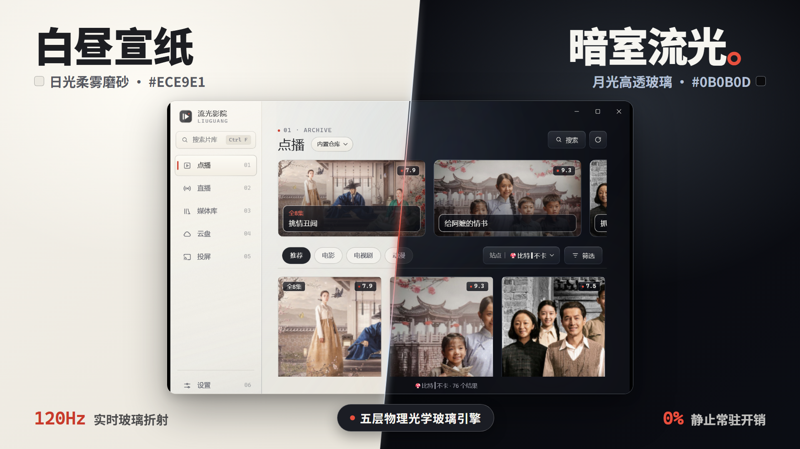
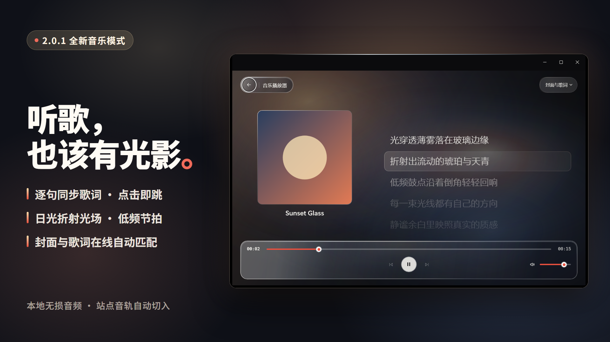
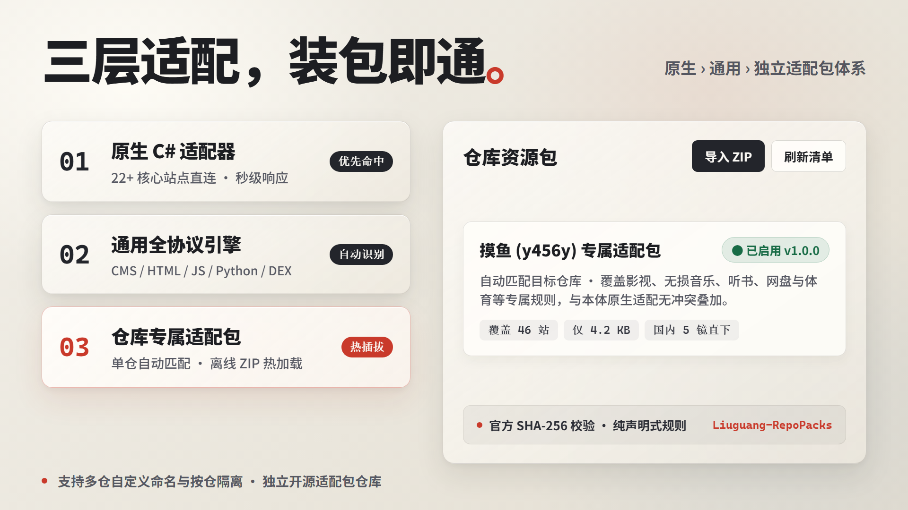
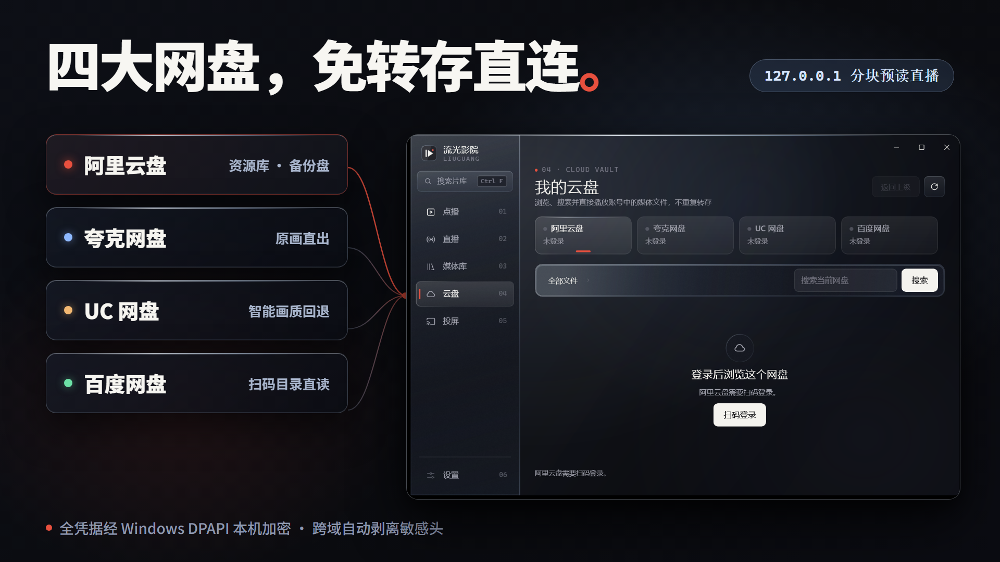
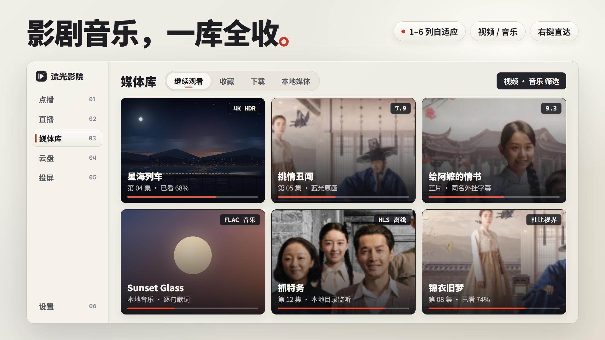
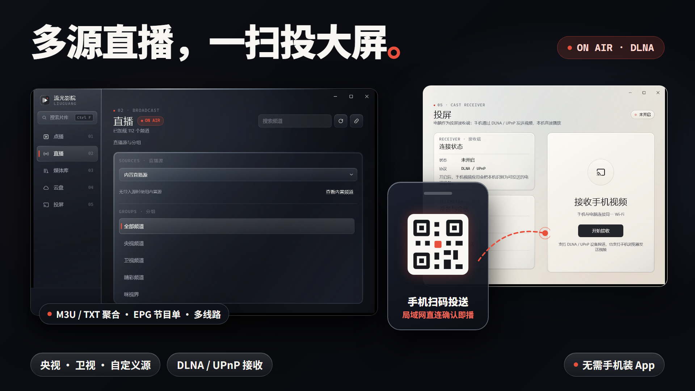
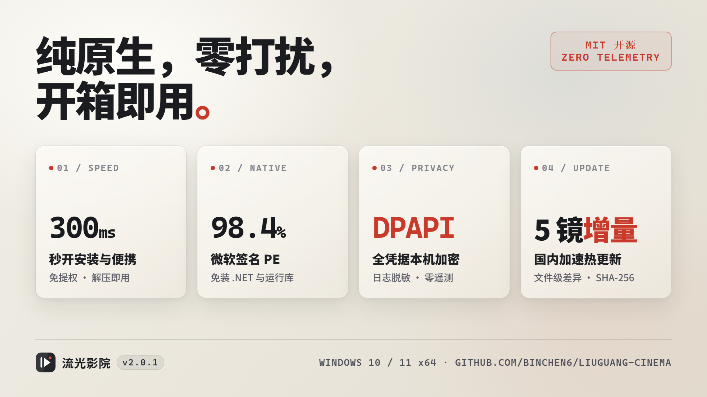

# 流光影院功能介绍

**流光影院（Liuguang Cinema）** 是一款基于 **C#、WinUI 3 与 LibVLC** 打造的 Windows x64 原生桌面影音客户端。聚焦**双主题光学玻璃美学、原生硬解与弹幕字幕播控、全新音乐播放器、三层全源与独立适配包体系、四大网盘直连、自适应媒体库、直播投屏与纯净本地隐私工程**，在一扇窗口内整合完整视听体验。

---

## 一、双主题光学玻璃美学

界面遵循「白与余白」克制层次，让海报、影片与音乐成为绝对主角：

- **白昼宣纸 × 暗室流光双主题**：浅色主题采用 `#ECE9E1` 温润护眼宣纸底布叠加日光柔雾磨砂与酸蚀微晶纹理；深色主题采用 `#0B0B0D` 暗室素墨搭配高通透月光玻璃与冷银菲涅尔外框；同步支持 Windows 高对比度模式。
- **专属 GPU 玻璃光影引擎（`GlassOpticsEngine`）**：在 DWM Compositor 线程实现体积透射、Snell 折射视差、Schlick Fresnel 倒角色散、顶部焦散游走光与点击波纹；`120Hz` 指针节流、静止零 GPU 开销，每屏宏观 `AcrylicBrush ≤ 4` 块。

---

## 二、原生硬件解码、自由弹幕与双语字幕

播放内核基于 **LibVLC**，默认开启 `:avcodec-hw=any` 硬件解码（不支持时平滑降级软解）：

- **零回弹精准拖拽与静默沉浸**：确定性状态机 `PlaybackSeekCoordinator` 消除进度条回弹与暂停抖动，无操作 3 秒自动隐匿控制坞与原生透明光标，播放期默认内核级防息屏/防休眠。
- **高刷弹幕与智能字幕**：内置弹弹play 开放弹幕库与 B 站弹幕，**支持自由自定义弹幕显示区域（1/4、半屏、3/4、全屏）、字号、透明度、速度、密度以及屏蔽词/正则过滤**；支持外挂字幕 ±60 秒偏移与调速，接入自有阿里云百炼 API Key 后支持 AI 自动生成、双语翻译与 WASAPI 实时字幕。

---

## 三、全新音乐播放器

本地音频文件或站点独立音轨会自动切入专属音乐舞台：

- **五层日光折射光场与节拍联动**：在支持进程音频回环的 Windows 上，背景光场与玻璃漫反射随低频节拍实时呼吸；严格遵循系统无动画与高对比度无障碍设置。
- **逐句歌词与封面匹配**：左侧光学玻璃专辑封面，右侧大号逐句高亮歌词（点击有时间戳的歌词即刻跳转）；自动读取内嵌/同名封面与歌词，并内置按曲名与歌手在线匹配及手动导入入口。

---

## 四、三层全源与独立适配包体系

按 **原生 C# > 通用全协议 > 仓库专属适配包** 分级兼容各类 TVBox 单仓、多仓与加密配置：

- **三层无缝协同**：内置 22+ 原生 C# 适配器与通用协议/自动 HTML/Jint JS/Python/Java DEX 引擎，支持导入自定义仓库名、随时重命名与按仓隔离。
- **独立开源适配包仓库（`Liuguang-RepoPacks`）**：针对特定仓库差异提供轻量化声明式 ZIP 资源包，导入目标仓库时自动通过国内 5 镜加速匹配下载，并支持在「设置 → 片源 → 仓库资源包」手动刷新、卸载或离线导入 ZIP，全程强制校验官方 SHA-256。

---

## 五、四大个人网盘直连

打通**阿里云盘**（资源库/备份盘 + 纯 C# 设备签名）、**夸克网盘**、**UC 网盘**（设备令牌与原画/转码智能回退）与**百度网盘**，通过本地 `127.0.0.1` 回环代理与分块缓存免转存直连播放，远距拖拽实时取消旧预读；全部凭据经 Windows DPAPI 本机加密存储。

---

## 六、自适应宽屏媒体库

媒体库「继续观看」采用 **1–6 列全宽自适应宽屏信息流**，随窗口宽度自动铺满视口；「本地媒体」支持按**视频与音乐**分类筛选、目录递归监听、同名侧车字幕/弹幕/封面歌词自动挂载，并支持 Windows 右键「打开方式」直达播放与单集/HLS 离线下载。

---

## 七、多源直播与扫码投屏

支持 M3U/TXT 直播源分组聚合、EPG 节目单与多线路切换；内置局域网 DLNA/UPnP 与手机浏览器扫码投屏接收，无需在手机端额外安装应用，电脑端确认即刻大屏播放。

---

## 八、纯净原生工程与本地隐私边界

- **开箱即用**：免管理员权限、免预装 .NET / Java / VC++ 运行库，微软签名 PE 占比 **98.4%**，安装器冷热启约 **300 ms**，同步提供支持原地自动更新的免安装便携 ZIP。
- **国内加速与本地优先**：共享 5 条国内 GitHub 镜像实现文件级双向差异增量更新并强制校验官方 SHA-256；全凭据 Windows DPAPI 本机加密、日志自动脱敏、零遥测上报。

---

## 获取方式

- **下载**：前往 [GitHub Releases](https://github.com/binchen6/Liuguang-Cinema/releases) 获取 `TV-Setup-<version>-x64.exe` 或便携包 `TV-<version>-win-x64-portable.zip`，并核对同页 `.sha256`。
- **源码与文档**：原创代码遵循 MIT 许可，开发构建、设计规范与验收文档见 [README](../README.md) 与 [文档中心](README.md)。

> 应用本身不托管任何影视资源，站点配置、仓库资源包、直播列表、网盘文件、字幕与弹幕均来自用户配置或第三方公开服务，请遵守相应服务条款。
