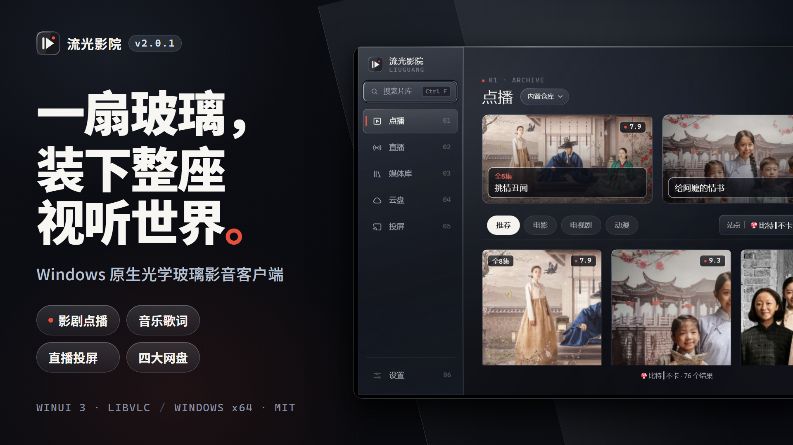
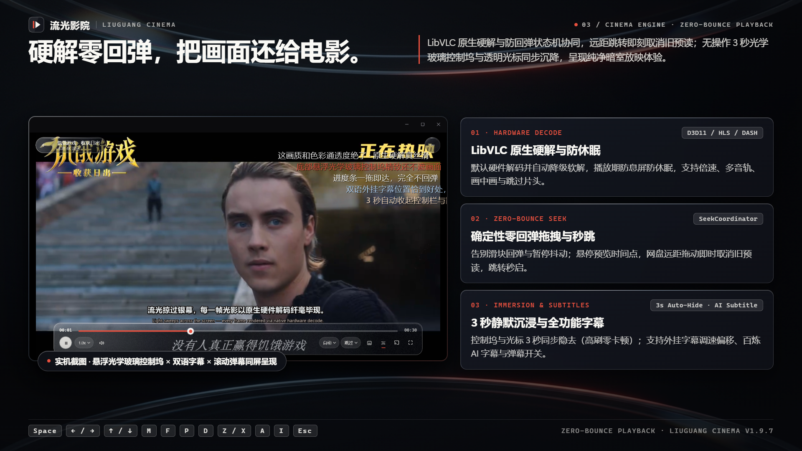
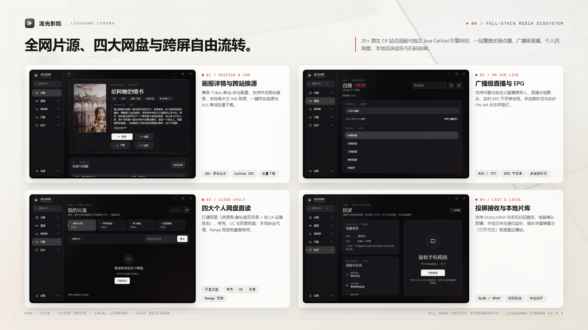

# 流光影院功能介绍

**流光影院（Liuguang Cinema）** 是一款基于 **C#、WinUI 3 与 LibVLC** 打造的 Windows x64 原生桌面影音客户端。聚焦**光学液态玻璃美学、三层全源自适应生态、原生硬解丝滑播控、多网盘与自适应媒体库，以及纯净私密的本地优先工程**，在一扇窗口内打通点播、直播、个人网盘、本地片库与跨屏接收。

---

## 一、光学玻璃美学与专属光影引擎

界面遵循低干扰留白与清晰层次，让海报与影片成为绝对主角：

- **暗室素墨与低眩光暖白双主题**：深色主题采用 `#0B0B0D` 低反光暗底；浅色主题采用 `#ECE9E1` 暖灰宣纸底色与柔墨字色，缓解长时间浏览眩光；同步提供完整 Windows 高对比度语义映射。
- **专属 GPU 玻璃光影引擎（`GlassOpticsEngine`）**：在 WinUI 3 DWM Compositor 线程构建四层实时光学交互——指针滑过时的**体积透射高光与 Snell 折射视差**、贴近边缘的 **Schlick Fresnel 倒角色散反光**、沿顶缘游走的**全内反射高光丝**以及点击触发的**焦散折射波纹**；120Hz 节流且静止时零常驻 GPU 消耗，每屏宏观 `AcrylicBrush` 严格控制在 `≤ 4` 块。
- **可打断物理弹簧动效**：页面切换、侧栏与分类滑轨、海报悬停、点播吸顶筛选坞收起均由 Composition 物理弹簧驱动，连点或反向滑动随时衔接，关闭系统动效后即刻静态落位。

---

## 二、原生硬件解码与丝滑播控

播放内核基于 **LibVLC**，默认开启 `:avcodec-hw=any` 硬件解码（不支持时自动平滑降级），配合高优先级合并控制队列带来跟手响应：

- **零回弹精准拖拽**：确定性状态机 `PlaybackSeekCoordinator` 结合 100 档微步进度条与 GPU 悬浮时间预览胶囊，消除缓冲期滑块回弹与暂停抖动；网盘与 HLS 远距拖拽时实时取消过期预读，显著缩短跳转起播等待。
- **纯粹沉浸观影**：播放中无操作 3 秒且鼠标未悬停控件时，光学玻璃控制坞平滑收起并隐藏原生透明光标（零高回报率鼠标移动卡顿）；默认开启内核级防息屏/防休眠，支持倍速、画质、画面比例、多音轨、逐集片头片尾跳过与画中画。
- **字幕、AI 字幕与弹幕功能**：支持外挂字幕 ±60 秒时间偏移与 `0.80x–1.25x` 调速；填入自有阿里云百炼 API Key 后可一键提取音轨生成时间轴字幕、双语翻译或开启 WASAPI 进程级实时字幕；同时内置弹弹play 开放弹幕库（含国内直连签名中继与 CDN 直连省流）与 B 站弹幕供按需开启。

---

## 三、三层全源自适应、网盘与自适应媒体库

- **三层全源适配 × 仓库资源包**：按 **原生 C# > 通用协议/自动 HTML/`drpy2 js:`+`CryptoJS`/Python/Java DEX 动态转译 > 仓库资源包** 分级兼容各类 TVBox 单仓、多仓与加密配置。导入仓库时可**自定义名称**并随时**重命名**，点播顶栏一键按仓切换且严格隔离；导入适配源（如 `www.y456y.com`）时自动通过国内 5 镜加速从 [Liuguang-RepoPacks](https://github.com/binchen6/Liuguang-RepoPacks) 下载对应资源包并完成 SHA-256 校验热启用，也可在「设置 → 片源」手动管理。
- **自适应宽屏媒体库**：继续观看采用 1–6 列全宽自适应信息流，随窗口宽度自动重排铺满视口、消除边缘留白；统一管理收藏、单集与 HLS 离线下载、本地目录递归监听、侧车字幕挂载及 Windows 右键「打开方式」直达播放。
- **四大个人网盘直连**：打通阿里云盘（资源库/备份盘 + 纯 C# 设备签名）、夸克、UC（设备令牌与原画/转码智能回退）与百度网盘，经本地 `127.0.0.1` 回环代理与分块预读免转存播放。
- **多源直播与扫码投屏**：支持 M3U/TXT 直播源分组聚合、EPG 节目单与多线路切换，并支持局域网 DLNA/UPnP 与手机扫码投屏接收（电脑端确认即播）。

---

## 四、纯净原生工程与本地隐私边界

- **免依赖开箱即用**：无需管理员权限，无需预装 .NET、Java 或 VC++ 运行库；发布包内微软签名 PE 占比达 **98.4%**，安装器关闭固实压缩且不嵌套外部 `.exe`，实测冷热启约 **220–450 ms**，同步提供支持纯净原地更新的免安装便携 ZIP。
- **国内加速双向增量更新**：复用共享 5 条国内 GitHub 镜像自动测速与多路 Range 分片下载，文件级双向差异补丁让日常升级通常控制在 10 MB 以内，全程强制核对官方 SHA-256。
- **本地加密与零遥测**：不向作者上报观影记录或账号信息；网盘 Cookie/Token、百炼 API Key 等敏感凭据全部经 Windows **DPAPI** 本机加密落库，跨域重定向严格剥离敏感请求头，日志自动脱敏。

---

## 获取方式

- **下载**：前往 [GitHub Releases](https://github.com/binchen6/Liuguang-Cinema/releases) 获取 `TV-Setup-<version>-x64.exe` 或便携包 `TV-<version>-win-x64-portable.zip`，并核对同页 `.sha256`。
- **源码与文档**：原创代码遵循 MIT 许可，开发构建、设计规范与验收文档见 [README](../README.md) 与 [文档中心](README.md)。

> 应用本身不托管任何影视资源，站点配置、仓库资源包、直播列表、网盘文件、字幕与弹幕均来自用户配置或第三方公开服务，请遵守相应服务条款。
